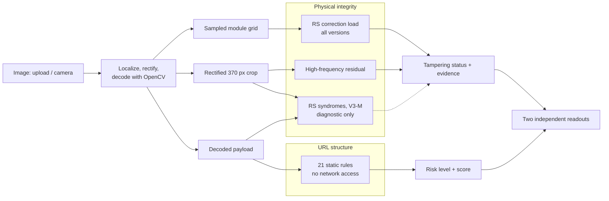
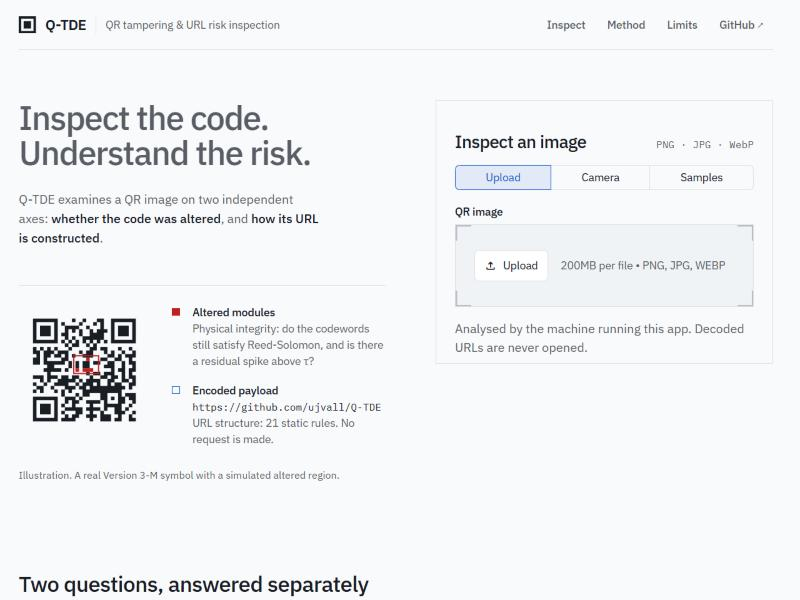
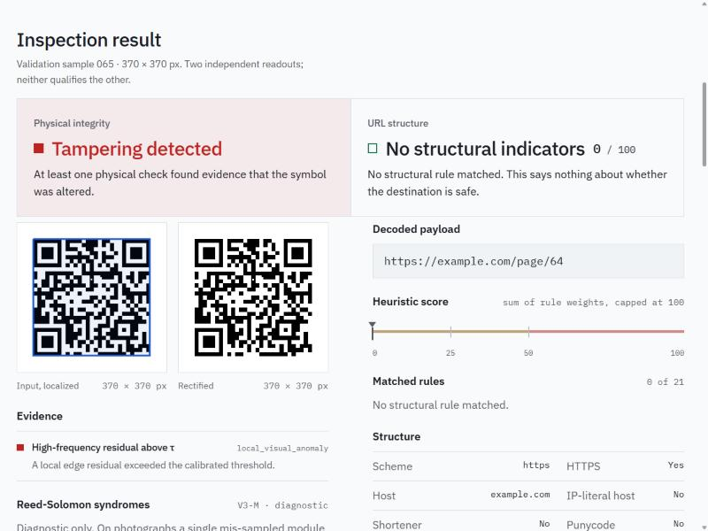
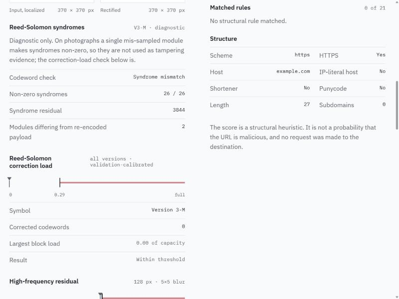

# Q-TDE

**QR Code Tampering & URL Risk Inspection System**

Q-TDE inspects a photo or export of a QR code along two independent axes: whether the printed
symbol shows signs of physical alteration, and whether the encoded URL has structural features
associated with abuse. It reports both results side by side and never merges them into a single
"safe" verdict.

[](https://www.python.org/)
[](https://streamlit.io/)
[](https://opencv.org/)

[Live demo](https://q-tdengine.streamlit.app/) · [Evaluation report](docs/EVALUATION.md) · [Dataset card](dataprep/DATASET_CARD.md)

## Overview

A QR code can be physically attacked, most often with a replacement sticker or by editing
modules. Its payload can also point somewhere harmful. These are different questions, and a
clean answer to one says nothing about the other. Q-TDE localizes and rectifies the symbol with
OpenCV. It then runs physical-integrity checks based on Reed-Solomon error correction and
image residuals, and a separate static analysis of the decoded URL. Nothing is fetched,
resolved or executed.

## Features

- **Localization and perspective correction:** OpenCV detection with an ArUco fallback, warped to
  a normalized 370 × 370 px crop.
- **Reed-Solomon integrity analysis:**
  - A correction-load check for **every version (1–40) and ECC level (L/M/Q/H)**, calibrated on
    validation data.
  - Version 3-M syndromes, shown as a diagnostic only, because on photos a single mis-sampled
    module makes them non-zero.
- **Visual anomaly detection:** a high-frequency residual on the rectified crop.
- **Independent URL structural-risk analysis:** 21 weighted rules covering scheme, host, path and
  query. It runs offline and its result never affects the physical readout.
- **Explicit hierarchical states:** `tampering_detected`, `no_tampering_evidence_detected`,
  `unsupported_geometry`, `decode_failed`, `detection_failed`, `unavailable`. "No evidence" is
  never reported as "genuine".
- **Streamlit interface** with upload, browser camera, server webcam and built-in samples.
- **Reproducible benchmark** with real photographs, leakage-safe splits and five learned baselines.

## Architecture



The learned models in `experiments/` are **not** part of this pipeline. See [Results](#results).

## Screenshots

| Inspector | Result | Physical evidence |
|---|---|---|
|  |  |  |

## Installation

Requires Python 3.11.

```powershell
git clone https://github.com/ujvall/Q-TDE.git
cd Q-TDE
python -m venv venv
venv\Scripts\activate          # macOS/Linux: source venv/bin/activate
pip install -r requirements.txt
```

## Usage

```powershell
streamlit run app/gui.py
```

Open `http://localhost:8501`, then upload a PNG, JPG or WebP image, take a browser-camera
snapshot, or pick one of the built-in samples. From the command line:

```powershell
python app/inspect.py path/to/qr.png
```

This prints the full structured result as JSON: tampering status, evidence, each check's raw
values, URL indicators and preprocessing metadata.

## Detection methodology

| Stage | What it does |
|---|---|
| Preprocessing | OpenCV `QRCodeDetector` (ArUco fallback) finds the four corners. The image is warped to 370 × 370 px with a four-module quiet zone, and the payload, version and sampled module grid are read from the original image. |
| RS syndromes (V3-M, diagnostic) | Re-samples the 29 × 29 grid, unmasks and de-interleaves 70 codewords, and computes 26 syndromes over GF(2⁸). Reported but not used as evidence: on photographs one mis-sampled module makes them non-zero (10–14 pp specificity cost in the ablation). |
| RS correction load (all versions) | Decodes each Reed-Solomon block of OpenCV's sampled grid and measures the largest share of a block's correction capacity that was used. A clean photo usually needs a few corrections; above **0.29** (95 % specificity on validation) it is evidence. |
| High-frequency residual | Peak of `abs(I − GaussianBlur(I)) / 255` on a 128 px rendering, against τ = 0.5255. |
| URL analysis | Parses the decoded payload locally and scores 21 structural rules (IP-literal hosts, shorteners, punycode, dangerous schemes, embedded credentials and similar) on a 0–100 scale. |
| Decision engine | Any physical evidence gives `tampering_detected`. Failures and unsupported geometry get their own states. The URL result is computed separately and never changes the physical status, and vice versa. |

## Dataset and training

| Data | Source | Licence | Use |
|---|---|---|---|
| Original synthetic set (`data/`) | Generated, 100 V3-M pairs | this repository | legacy comparison |
| Simulated captures | `dataprep/build_benchmark.py`, 1 000 QR identities, versions 1–8, ECC L/M/Q/H, 7 tampering categories | this repository | train / val / synthetic test |
| QR codes on different surfaces | [Mendeley Data, doi:10.17632/m6mfwc52vk.1](https://doi.org/10.17632/m6mfwc52vk.1), 100 real photos | CC BY 4.0 | real-world test only |
| Szeged visual-code database, Huawei subset | [Bodnár et al. 2018](https://doi.org/10.1007/s10044-017-0619-6), 98 real photos | no licence stated, citation requested; local use only | external test only |

No public dataset of *photographed, physically tampered* QR codes with retained originals could be
found. Tampering on the real photos is therefore applied digitally and geometry-aware, and
[`dataprep/COLLECTION_PROTOCOL.md`](dataprep/COLLECTION_PROTOCOL.md) describes how to collect
physical captures. Splits are grouped by QR identity, and real photos are never used for training
or threshold selection. `dataprep/validate_benchmark.py` checks for identity, payload, pair,
exact-duplicate and near-duplicate leakage. Details and every candidate dataset that was checked
are in the [dataset card](dataprep/DATASET_CARD.md).

The external datasets (about 0.4 GB) and the built benchmark are **not** committed. To reproduce:

```powershell
python -m dataprep.acquire                 # download external datasets to data/external/
python -m dataprep.build_benchmark         # build data/benchmark/ (~3 400 images)
python -m dataprep.validate_benchmark      # integrity and leakage checks
python -m experiments.classical            # score classical detectors
pip install -r requirements-train.txt      # torch, transformers, scikit-learn
python -m experiments.learned              # train ResNet-18, ViT-B/16, autoencoder, PatchCore
python -m experiments.benchmark            # thresholds from validation, report with CIs
```

## Results

Recall / specificity in %. Thresholds are set on the validation split only, at 95 % specificity.
Full tables with CIs, F1, ROC-AUC, PR-AUC, confusion matrices and per-category results are in
[`docs/EVALUATION.md`](docs/EVALUATION.md).

| Detector | Synthetic test | Real (Mendeley) | External (Szeged) | Status |
|---|---|---|---|---|
| Original engine (before this work) | 15.1 / 85.3 | 0.0 / 100 | 0.0 / 100 | replaced |
| **Current engine (RS correction load + peak)** | **40.4 / 95.1** | **23.5 / 99.0** | **44.7 / 89.8** | **active** |
| ViT-B/16, fine-tuned | 59.6 / 93.3 | 79.4 / 39.0 | 86.8 / 25.5 | experimental |
| ResNet-18, fine-tuned | 56.0 / 92.4 | 44.1 / 70.0 | 85.5 / 20.4 | experimental |
| ViT-B/16, frozen + linear probe | 40.4 / 92.9 | 47.1 / 79.0 | 52.6 / 66.3 | experimental |
| Conv autoencoder (one-class) | 4.4 / 94.7 | 14.7 / 79.0 | 1.3 / 99.0 | experimental |
| PatchCore-style kNN (one-class) | 6.7 / 96.9 | 20.6 / 58.0 | 42.1 / 57.1 | experimental |

On the original 30-image synthetic splits the current engine scores 13.3 % (test) and 6.7 %
(validation) sensitivity at 100 % specificity; the original engine scored 13.3 % on both. The
validation difference is one sample whose only signal was a V3-M syndrome mismatch. The new component adds recall on every independent split
(paired 95 % CIs exclude zero). The fine-tuned classifiers rank real photos well (ViT external
ROC-AUC 0.82), but at their validation-calibrated thresholds they flag most genuine real photos,
so they are not used.

## Limitations

- **Coverage.** The correction-load check covers all versions, but only when the payload decodes
  from the original image. The syndrome diagnostic supports Version 3-M only.
- **What ECC cannot see.** A replacement sticker that carries a different, valid QR code produces
  no Reed-Solomon errors, and sub-module edits that leave each module's majority colour intact are
  not counted. On real photos the active engine catches 0 of 15 sticker replacements.
- **Evidence, not proof.** "No tampering evidence" never means the code is genuine. On the
  external set the engine still raises false alarms on about 10 % of genuine photos.
- **URL scores are structural heuristics,** not probabilities of harm. There is no live
  threat intelligence, reputation lookup or page fetch.
- **Real-photo tampering is digital.** The real-world results measure transfer to real capture
  conditions, not detection of real physical attacks; a physical test set has yet to be collected.
- **The learned models remain experimental** and are not loaded by the app.

## Project structure

```text
app/            Streamlit GUI, CLI and inspection service
preprocessing/  OpenCV localization, rectification, decoding; original synthetic data scripts
ecc/            Reed-Solomon analysis (V3-M reference and version-generic rs_generic.py)
fusion/         Hierarchical decision engine and original evaluation scripts
url_analysis/   Static URL structural-risk analyzer
dataprep/       Dataset acquisition, benchmark builder, validator, dataset card, capture protocol
experiments/    Classical and learned detectors, benchmark report, latency
models/         Original ViT and autoencoder experiments (benchmark checkpoints are not committed)
results/        Benchmark report, metrics, dataset statistics, figures
docs/           Evaluation report and screenshots
data/           Original synthetic dataset (external and built data are git-ignored)
site/           Landing page
```

## Future work

- Collect the physical tampering set described in the capture protocol and use it as the
  definitive test.
- Calibrate learned detectors on a labelled set of genuine *real* photos. Their ranking quality
  suggests they would complement ECC on sticker replacement once calibration transfers.
- Use reference-payload checks where a trusted expected payload is known.

## Licence and citations

No licence file is included in this repository. External datasets keep their own terms and are
not redistributed here. If you use the benchmark, please cite:

- *A dataset of QR Codes on top of different surfaces (flat and challenging surfaces)*, Mendeley Data, V1. doi:10.17632/m6mfwc52vk.1
- P. Bodnár, T. Grósz, L. Tóth, L. G. Nyúl. *Efficient visual code localization with neural networks.* Pattern Analysis and Applications 21, 249–260 (2018). doi:10.1007/s10044-017-0619-6
- A. Dosovitskiy et al. *An Image is Worth 16x16 Words: Transformers for Image Recognition at Scale.* ICLR 2021.
- K. Roth et al. *Towards Total Recall in Industrial Anomaly Detection* (PatchCore). CVPR 2022.
